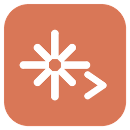
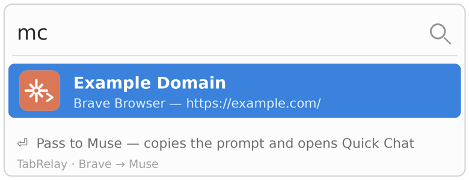
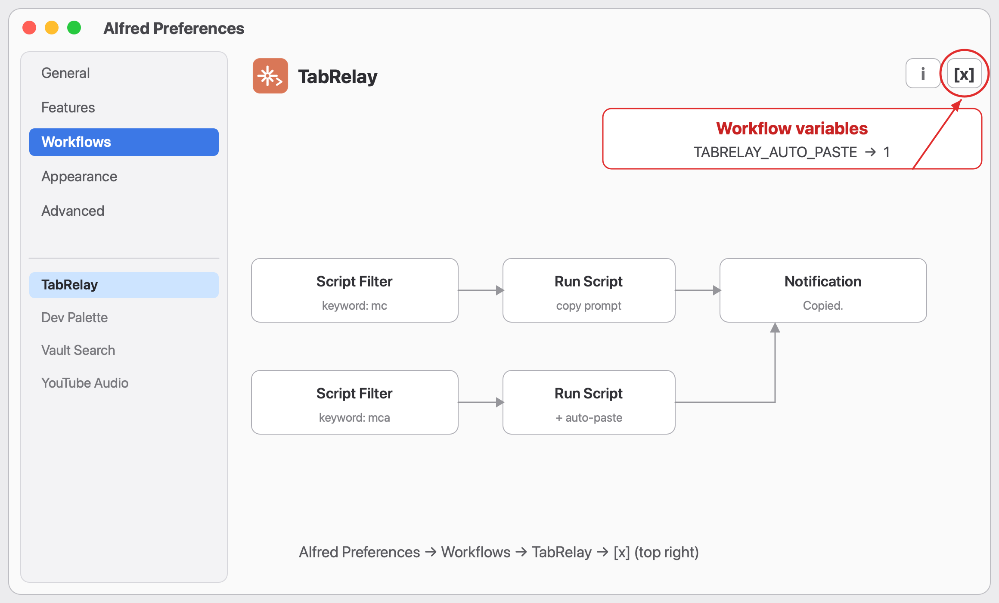

# TabRelay — Alfred ワークフロー

**Brave / Chrome / Chromium** で読んでいるページを、Mac の **Muse** アプリへ2ストロークで渡すワークフローです。

Alfred で `mc` と入力すると、起動中の対応ブラウザの現在のタブが候補に出ます。渡したいものを選んで Enter を押すと、ページのタイトルと URL を入れた依頼文がクリップボードにコピーされ、Muse の Quick Chat が開きます。あとは ⌘V で貼って送信するだけです。

英語版は `TabRelay-EN.alfredworkflow`、日本語版は `TabRelay-JA.alfredworkflow` です。キーワード `mc` が重なるので、どちらか一方だけを入れてください。

English: [README.md](README.md)

## 動作環境

- macOS
- Alfred 4 または 5（ワークフローには Powerpack が必要です）
- Brave Browser / Google Chrome / Chromium のいずれか
- Muse for Mac（Quick Chat のショートカットが既定の Option+Space のままであること）

## プレビュー

Alfred で `mc` と打つと、起動中の対応ブラウザの現在のタブ（タイトルと URL）が Muse へ渡せる状態で並びます。

## アイコンのバリエーション

  

既定は A（スパーク）です。3種類ともパッケージに同梱されています。切り替え方：Alfred の設定で TabRelay ワークフローを右クリック →「Open in Finder」で開き、`icon-b.png`（または `icon-c.png`）を `icon.png` にリネームして上書きしてください。

## インストール

1. このリポジトリの `dist/` フォルダ、または Releases から `TabRelay-JA.alfredworkflow` をダウンロード
2. ファイルをダブルクリックすると Alfred に取り込まれます
3. Brave / Chrome / Chromium でページを開き、Alfred で `mc` と入力してタブを選んで Enter

## 許可について

- **自動化（オートメーション）**: 初回実行時に「Alfred がブラウザを制御してもよいか」と聞かれます。AppleScript で現在のタブのタイトルと URL を読むために必要なので、許可してください
- **アクセシビリティ**（任意）: Quick Chat を Option+Space のキー入力で自動で開くために使います。許可しなくても動作します。その場合は Option+Space を自分で押してから貼り付けてください

## すること / しないこと

- 読むのは**現在のタブのタイトルと URL だけ**です。履歴や他のタブは読みません
- テキストは**自分のクリップボード**に入るだけです。どこかへ送信されることはなく、Muse への送信も自動では行われません（貼り付けと送信は自分の操作です）
- 記事本文の抽出はしません。本文まで綺麗に抜きたい場合は Obsidian Web Clipper のような専用ツールの方が向いています。これは「このページを見て」と軽く渡すためのものです

## 自動ペースト（任意設定）

既定では、依頼文をコピーして Quick Chat を開くところまでで、貼り付け（⌘V）と送信は手作業です。

**簡単な方法：キーワード `mca` を使ってください。** `mc` と同じ候補が出て、Enter で Quick Chat への貼り付けまで代行します。送信は手作業のままです。

`mc` 自体を常に自動ペーストにしたい場合は、ワークフロー変数 `TABRELAY_AUTO_PASTE` を `1` にします。

1. Alfred の設定 → **Workflows** → **TabRelay** を選択
2. ワークフローエディタ **右上** の **[x]** ボタンをクリック
3. Workflow Environment Variables で `TABRELAY_AUTO_PASTE` を `1` に変更

自動ペーストは Quick Chat を開いた後に ⌘V を代行送信する方式で、Alfred のアクセシビリティ許可と、Muse 側の Quick Chat ショートカット（Option+Space）が有効なことが前提です。貼り付けの成否は確認できないため、この場合は通知で Quick Chat の確認を促します。

## 仕組み

小さな zsh スクリプト（`src/tabrelay`）が AppleScript 経由で対応ブラウザとやり取りします。配布用ワークフローにはスクリプトを埋め込んであるので、他にインストールするファイルはありません。`./build.py` を実行すると `src/` から `dist/` のパッケージを再生成できます。

## リンク

- [Alfred](https://www.alfredapp.com/workflows/) — このワークフローの実行環境
- [Alfred ヘルプ：ワークフローの変数](https://www.alfredapp.com/help/workflows/advanced/variables/) — `TABRELAY_AUTO_PASTE` のようなワークフロー変数の解説（英語）
- [Awesome Alfred Workflows](https://github.com/alfred-workflows/awesome-alfred-workflows) — Alfred ワークフローのキュレーションリスト（英語）

## ライセンス

MIT — [LICENSE](LICENSE) をご覧ください。
