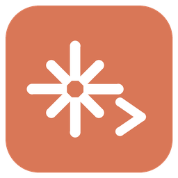
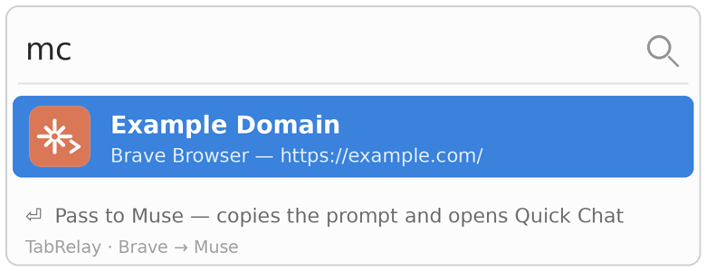
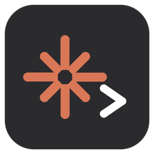
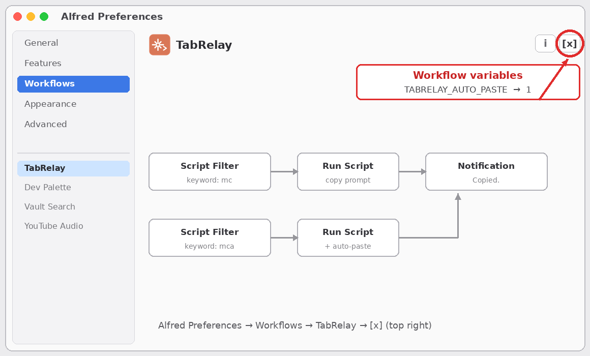

# TabRelay — an Alfred workflow

**Hand the page you're reading to your Muse agent.**

Pass the page you are reading in **Brave**, **Google Chrome** or **Chromium** to **Muse** (the Mac app) in two keystrokes.

Type `mc` in Alfred, and the active tab of each running supported browser appears as a result. Pick one, press Enter, and a ready-to-send prompt — the page title and URL — is copied to your clipboard and Muse's Quick Chat opens. Paste (⌘V), send, done.

A Japanese version is included as `TabRelay-JA.alfredworkflow`; the English one is `TabRelay-EN.alfredworkflow`. Install only one of them (both use the keyword `mc`).

日本語の説明は [README.ja.md](README.ja.md) をご覧ください。

## Requirements

- macOS
- Alfred 4 or 5 with the Powerpack (required for workflows)
- Brave Browser, Google Chrome or Chromium (whichever you are reading in)
- Muse for Mac, with Quick Chat on its default shortcut (Option+Space)

## Preview

Type `mc` in Alfred and the active tabs of your running browsers are listed — pick one to pass to Muse.

## Icon variants

  

A (spark) is the default. All three icons are bundled in the package. To switch: in Alfred Preferences, right-click the TabRelay workflow and choose "Open in Finder", then rename `icon-b.png` (or `icon-c.png`) to `icon.png`, replacing the existing file.

## Install

1. Download `TabRelay-EN.alfredworkflow` (or the JA file) from this repository's `dist/` folder or from Releases.
2. Double-click the file. Alfred imports the workflow.
3. Open a page in Brave, Chrome or Chromium, launch Alfred, type `mc`, choose the tab, press Enter.

## Permissions

- **Automation**: the first run asks whether Alfred may control your browser. Allow it — the workflow reads the active tab's title and URL via AppleScript.
- **Accessibility** (optional): used to open Quick Chat automatically with an Option+Space keystroke. Without it, everything still works; just press Option+Space yourself before pasting.

## What it does / does not do

- Reads **only the active tab's title and URL**. No browsing history, no other tabs.
- Puts plain text on **your clipboard**. Nothing is uploaded anywhere, and nothing is sent to Muse automatically — you paste and send it yourself.
- It does **not** extract the article body. If you need full-text clipping, a tool such as Obsidian Web Clipper is the better fit; this workflow is the lightweight "take a look at this page" path.

## Auto-paste (optional)

By default, TabRelay copies the prompt and opens Quick Chat; you paste with ⌘V and send.

**The easy way: use the `mca` keyword instead of `mc`.** It lists the same tabs, but pressing Enter also pastes the prompt into Quick Chat for you. Sending stays manual.

If you want `mc` itself to always auto-paste, set the workflow variable `TABRELAY_AUTO_PASTE` to `1`:

1. Open Alfred Preferences → **Workflows** → select **TabRelay**
2. Click the **[x]** button in the **top right** of the workflow editor
3. In the Workflow Environment Variables, set `TABRELAY_AUTO_PASTE` to `1`

Auto-paste simulates ⌘V after opening Quick Chat, so it needs Alfred's Accessibility permission and Muse's Quick Chat shortcut (Option+Space) enabled. The paste cannot be verified, so in this mode the notification asks you to check Quick Chat before sending.

## How it works

A small zsh script (`src/tabrelay`) talks to each supported browser via AppleScript. In the distributed workflows the script is embedded directly into the workflow, so there are no other files to install. Run `./build.py` to regenerate the packages in `dist/` from `src/`.

## License

MIT — see [LICENSE](LICENSE).
